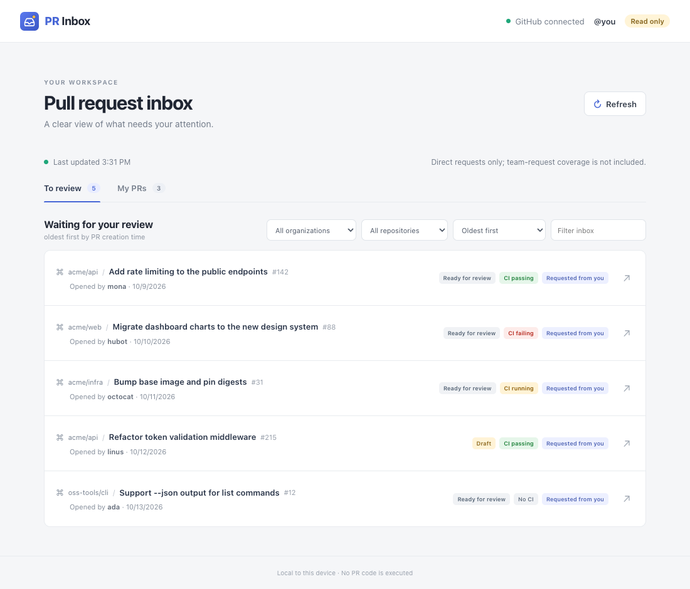
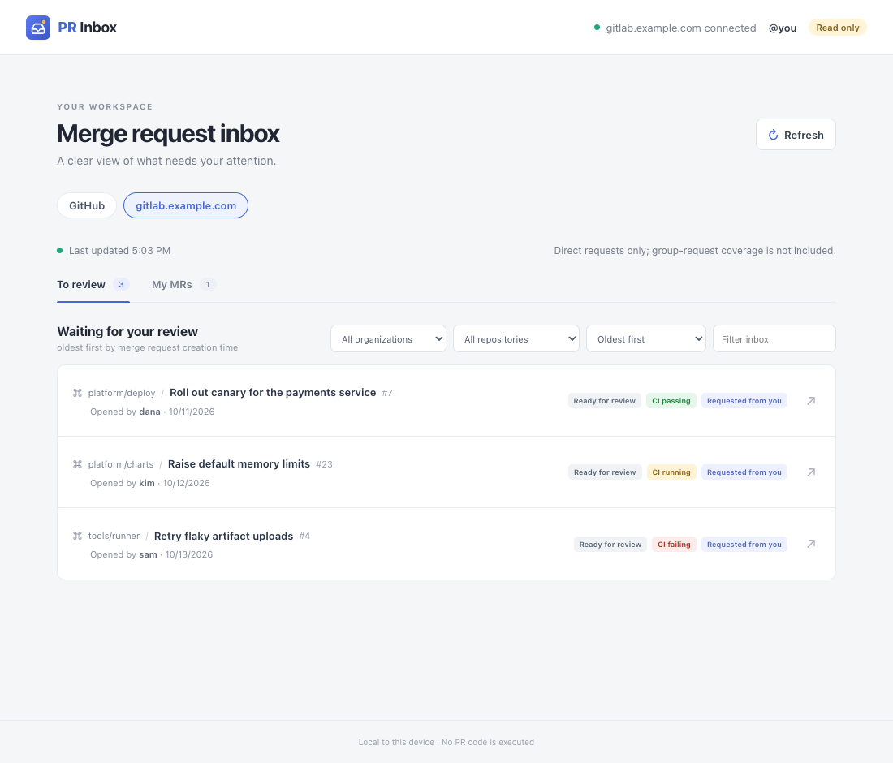

<p align="center">
  
</p>

# PR Inbox

A local GitHub pull request inbox. The Go server reads the existing GitHub CLI
authentication and serves an embedded browser interface on loopback.





The screenshots use sample data (`--demo`). With more than one provider, each gets its own tab.

## Current implementation

Milestone 1 is implemented: authenticated **To review** and **My PRs** queues,
organization and repository filters, CI status labels, capped discovery, explicit
direct-request-only coverage, and a read-only local UI. Clicking a PR/MR title
opens a detail panel with its description (plain text), author, branches, head
commit, and CI summary for that commit. The panel is available for GitHub,
GitLab, and demo data; discussion and full check results remain on the provider.

## Roadmap

Work in delivery order. Unchecked items are planned and the scope may change.

- [x] **Milestone 1 – Read-only inbox:** authentication, review-requested and authored queues, filters, CI status, coverage labels, links.
- [ ] **Milestone 2 – Review workspace:**
  - [x] Read-only PR/MR details: plain-text description, author, branches, head commit and CI summary
  - Discussion
  - Diffs pinned to a commit, with large, binary and truncated diff handling
  - Check summaries
  - Local review drafts and "viewed" markers
- [ ] **Milestone 3 – Overall review writes:**
  - Submit an overall review (approve, comment, request changes) after an explicit confirmation
  - Safety checks that the head commit is unchanged and no pending review exists
  - Operation tracking and refresh after submitting
- [ ] **GitLab support:**
  - [x] Provider-neutral internal model (pull request / merge request)
  - [x] GitLab.com and self-hosted instances (`--gitlab`, repeatable) with merge requests to review, authored merge requests and pipeline status
  - [x] One tab per provider instance in the UI; a single GitHub provider keeps the current layout
- [ ] **Later:**
  - Team review-request coverage
  - Inline comments
  - Saved preferences

## Requirements

- Go and Node.js 24 to build from source (not needed for a release binary).
- To see **GitHub**: the [GitHub CLI (`gh`)](https://cli.github.com/) logged in with
  `gh auth login`, or a `GITHUB_TOKEN` / `GH_TOKEN` environment variable.
- To see **GitLab**: the [GitLab CLI (`glab`)](https://gitlab.com/gitlab-org/cli) logged in
  with `glab auth login`, or a personal access token with the `read_api` scope in
  `GITLAB_TOKEN` (see [GitLab](#gitlab)).

You only need the providers you use. GitHub and gitlab.com are tried automatically:
a provider without credentials logs a warning in the terminal and its tab explains
how to log in. If neither has credentials, the program exits with that explanation.

## Build and run

```sh
gh auth login      # and/or: glab auth login
make build
./dist/pr-inbox
```

Useful options:

| Command | What it does |
| --- | --- |
| `./dist/pr-inbox` | Starts the local server and opens the inbox in your default browser. |
| `./dist/pr-inbox --no-open` | Starts the server and only prints the launch URL, without opening a browser. Useful over SSH or to pick a specific browser. |
| `./dist/pr-inbox --org ossf --org sigstore` | Limits discovery to the given organizations. Repeat `--org` for each one. Without it, PRs from every organization and account you can see are searched. |
| `./dist/pr-inbox --gitlab gitlab.example.com` | Also lists merge requests from a self-hosted GitLab. Repeat `--gitlab` for each instance. gitlab.com is added automatically. See [GitLab](#gitlab). |
| `./dist/pr-inbox --no-github` | Skips GitHub, for people who only use GitLab. |
| `./dist/pr-inbox --no-gitlab` | Skips the automatic gitlab.com tab. |
| `./dist/pr-inbox --read-only` | Opt-in guard against write operations. It has no effect today: the current version is always read-only (it only reads from GitHub), so you don't need to pass it. It exists so that, once actions such as review submission are added, you can disable them explicitly. Defaults to off. |
| `./dist/pr-inbox --demo` | Runs with built-in sample data instead of GitHub. No `gh` or authentication is needed and no network calls are made, so it is a safe way to try the interface (and how the README screenshot is produced). Can be combined with `--org` and `--no-open`, but not with `doctor`. |
| `./dist/pr-inbox doctor` | Checks that `gh` is installed and authenticated and that the GitHub API (and every `--gitlab` host) is reachable, prints the accounts, then exits without starting the server. `--doctor` works too. |

Pull requests from archived repositories are never listed. Inside the UI, the
organization and repository selectors narrow the loaded queue (the repository
list only shows repositories of the selected organization), unlike `--org`,
which narrows what is fetched from GitHub.

The server binds only to `127.0.0.1` on an OS-assigned port. The browser launch
link contains a one-launch secret in its URL fragment; the secret is exchanged
for a local, HttpOnly, SameSite session and removed from the address bar. GitHub
credentials stay in the Go process and are never sent to the browser.

## GitLab

gitlab.com is added automatically; if no token is found you get a warning and a
tab with login instructions (`--no-gitlab` turns it off). `--gitlab HOST` adds a
self-hosted instance and can be repeated. Only HTTPS is supported.

Create a [personal access token](https://docs.gitlab.com/user/profile/personal_access_tokens/)
with the `read_api` scope and expose it through an environment variable. Tokens
are never written to disk and are only sent to the host they belong to:

| Host | Environment variable |
| --- | --- |
| `gitlab.com` | `GITLAB_TOKEN` |
| `gitlab.example.com` | `GITLAB_TOKEN_GITLAB_EXAMPLE_COM` (upper-case host, every other character becomes `_`) |

If the variable is not set, `glab config get token --host HOST` is tried as a
fallback, so `glab auth login` works too. A GitLab.com token is never reused for
another host.

```sh
export GITLAB_TOKEN=glpat-...
export GITLAB_TOKEN_GITLAB_EXAMPLE_COM=glpat-...
./dist/pr-inbox --gitlab gitlab.example.com
```

Notes:

- `--org` applies to GitHub only; GitLab shows everything you can see.
- A self-hosted instance with a private CA is trusted through the standard
  `SSL_CERT_FILE` / `SSL_CERT_DIR` environment variables; certificate checks are never disabled.
- Pipeline status needs one extra request per merge request, so GitLab queues with
  many items load more slowly than GitHub ones.
- With more than one provider, the UI shows a tab per instance (GitHub first; providers without
  credentials come last and show login instructions); each loads on first open. A single provider keeps the plain layout.
- `--demo` includes a sample GitLab instance, so you can try the tabs without credentials.

## Development

Building from source needs Go 1.27, Node.js 24.x with npm (see `.nvmrc`) for
the embedded frontend, and an authenticated GitHub CLI (`gh`).

```sh
make test
```

`make build` and `make test` build the frontend before running Go commands because
the generated frontend is embedded in the binary.

## Releases

Releases are built by GitHub Actions when a `v*` tag is pushed. GoReleaser
produces archives for Linux, macOS, and Windows on amd64 and arm64, plus a
SHA-256 checksum file. To test a release locally, run `make release-snapshot`
with GoReleaser installed.

### Verifying a release

`checksums.txt` is signed keylessly with [cosign](https://github.com/sigstore/cosign)
from the release workflow. Download the archive, `checksums.txt` and
`checksums.txt.sigstore.json` from the release, then:

```sh
cosign verify-blob checksums.txt \
  --bundle checksums.txt.sigstore.json \
  --certificate-identity-regexp '^https://github.com/cpanato/pr-inbox/\.github/workflows/release\.yaml@refs/tags/v.+$' \
  --certificate-oidc-issuer https://token.actions.githubusercontent.com

sha256sum --ignore-missing -c checksums.txt   # macOS: shasum -a 256 --ignore-missing -c checksums.txt
```

The first command proves the checksum file was produced by this repository's
release workflow; the second proves your archive matches it.
